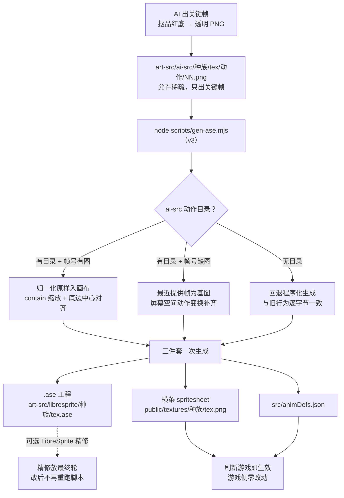

# 资源需求 —— AI 生图规格

> 目标：用 AI 批量生成三个种族的资源贴图，替换 Textures.ts 的程序化 canvas 绘制。
> 本文确定**方向规格**与**尺寸规格**，作为出图与接入的依据。
> **直接出图请用同目录 `AI出资源清单.md`**（96 条逐条执行版，prompt 已拼好），本文是规格依据与工程接入说明。

## 1. 方向规格：分级出图，不是全部八方向

当前渲染管线是**单帧模型**：`Def.tex` 单 key、Textures.ts 单帧 canvas、entities 无方向字段（无 flipX/rotation/朝向分桶）。因此方向按对象类型分级：

| 批次 | 对象 | 方向数 | 说明 |
|---|---|---|---|
| **1（先行）** | **地图资源：地形 tileset + 水晶矿 + 瓦斯气泉** | **单帧** | **风格锚点**：决定全画面色调/材质/光照基准，必须最先出图锁定，否则后续单位/建筑与地图风格冲突 |
| 2 | 建筑（三族全部） | **单帧** | 星际建筑无朝向语义；以批次 1 的地形图为风格参照出图 |
| 3 | 单位（三族全部） | **1 帧 + flipX 镜像** | entities 加 `setFlipX(朝向)` 即 2 方向，管线改动最小 |
| 4（可选） | 主力地面单位 | **8 方向** | 需 Def 加 `frames` 字段 + 移动向量按 45° 分桶选帧；AI 多帧角色一致性需多次抽卡，后置 |

> 八方向的真实成本在**角色一致性**：同一单位 8 个角度的风格漂移是当前文生图最难保证的，故作为第三批增强而非首批需求。

## 2. 尺寸规格

依据：地图 tile 64×32（2:1 等距菱形）；现有程序画尺寸——矿 48×52、气泉 52×52、单位默认 26×26、建筑 48×48。

出图尺寸 = **显示尺寸 × 2**（保留缩放余量），运行时按需缩到 `Def.w/h`。

| 类别 | 出图（px） | 显示（px） | 覆盖对象 |
|---|---|---|---|
| **地形 tileset（5 帧）** | **128×128/帧** | 64×64/帧 | low 高草地 / high 亮草地 / ramp 坡道 / water 水面 / bridge 桥面 |
| 水晶矿 | 96×104 | 48×52 | 对齐 RESOURCE_DEFS 比例（2026-10-15 调大） |
| 瓦斯气泉 | 104×104 | 52×52 | 对齐 RESOURCE_DEFS 比例（2026-10-15 调大） |
| 小型单位 | 64×64 | ~32×32 | SCV、枪兵、probe、小狗、drone |
| 中型单位 | 96×96 | ~48×48 | 坦克、龙骑士、刺蛇、火蝠 |
| 大型单位 | 128×128 | ~64×64 | 雷神、航母、雷兽、执政官 |
| 小建筑 | 128×128 | ~64×64 | 补给站、兵营、地堡、气矿 |
| 大建筑 | 256×256 | ~128×128 | 指挥中心、孵化场、枢纽 |
| 特效·命中火花 | 64×64 | ~32×32 | `fx_hit`，**纯黑底**（ADD 混合免抠图） |
| 特效·爆炸云 | 128×128 | ~64×64 | `fx_explosion`，**纯黑底**（ADD 混合免抠图） |

### 2.1 地形 tileset 专项规格（批次 1 核心）

当前地形渲染：`public/maps/terrain.png` **320×64 = 5 帧横排，每帧 64×64**（low/high/ramp/water/bridge 顺序），由 lost-temple.tmj 引用。AI 替换必须遵守：

- **布局不变**：合成后仍为 320×64（5×128×128 缩回 5×64×64），否则需同步改 lost-temple.tmj 的 tileset 定义与 tile 尺寸
- **菱形顶面**：每帧上半部为 64×32 菱形顶面（2:1），下半部为侧面土层带；四角留透明（tile 菱形外的区域）
- **色调基准**（对齐当前地图基调）：草地暗绿系（low ≈ #285228、high ≈ #487438）、水面深蓝（≈ #1c385e）、坡道土黄、桥面木褐
- **接缝约束**：相邻同类型 tile 的草地/水面纹理需连续——出图时要求纹理均匀、避免中心聚焦的独特痕迹（独特地标会造成平铺重复感）
- **出血**：每帧菱形边缘纹理向外多画 2~4px，缩回 64×64 后裁掉，避免缩放采样露缝

### 2.2 风格锚点流程

1. 批次 1 先出**地形 low 草地**单帧 → 确认色调/材质/光照 → 以它为风格卡（style reference）
2. 同批次其余 4 帧地形 + 矿 + 气泉按同一风格卡出图，保证同一张地图上视觉统一
3. 批次 2/3（建筑/单位）出图时 prompt 附带地形风格卡描述（同一光源方向、同一饱和度/材质语言），避免“单位像另一个游戏”的冲突

## 3. 出图统一约束

- **视角**：等距 2:1 菱形俯视（dimetric，约 30° 俯角），与地图 tile 64×32 对齐
- **背景**：透明 PNG（最终接入格式）。注意：多数生图模型（SD/MJ/即梦）不能直接输出 alpha 通道，实操为**纯品红底（#FF00FF）出图 → 后期抠图转透明 PNG**（品红在游戏素材中最少误伤）；地形 tile 的菱形四角同理抠透明。**特效例外**：`fx_hit`/`fx_explosion` 用**纯黑底（#000000）**出图——游戏里 ADD 混合模式黑=透明，**免抠图**直接覆盖
- **光源**：统一左上方（与程序画阴影方向一致，entities 已画脚下椭圆阴影）
- **风格**：像素风/低多边形插画风任选其一后全批次锁定（混用会穿帮）
- **命名**：`Def.tex` 字段即纹理 key（如 `b_cc`、`u_scv`、`mineral`）。**地图资源**（地形/矿/气泉）抠图后按 **`maps/<tex>.png`** 命名覆盖 `public/textures/maps/` 占位图；**单位/建筑关键帧**放 **`art-src/ai-src/<race>/<tex>/<动作>/NN.png`**（见第 4 节注入管线，勿直接覆盖 public/textures——横条由 gen-ase.mjs 统一生成）。特效 `fx_hit`/`fx_explosion` 仍按 `fx/<tex>.png` 覆盖（黑底免抠）

## 4. 接入管线：AI 关键帧 → gen-ase.mjs 注入（已实现）

单位/建筑的 AI 关键帧**不直接进 public/textures**（横条 spritesheet 由脚本统一生成，手放会被覆盖），而是放 `art-src/ai-src/` 由 `scripts/gen-ase.mjs`（v3）注入 .ase 工程与横条。

**管线总览**：



### 4.1 目录与帧号

```
art-src/ai-src/<race>/<tex>/<action>/NN.png
```

- `<race>`：terran / protoss / zerg；`<tex>`：纹理 key（如 `u_scv`、`b_cc`）
- `<action>`：单位 `idle/walk/attack/death`，建筑 `idle/build/death`
- `NN`：动作内两位帧号（`00.png` 起），**允许稀疏**——只出关键帧，缺帧脚本自动补
- 帧数规格：单位 idle 6 / walk 8 / attack 6 / death 6；建筑 idle 8 / build 6 / death 6（越界帧号忽略并告警）

### 4.2 注入规则

| 情形 | 行为 |
|---|---|
| 动作目录存在 + 该帧号有图 | 归一化（contain 缩放 + 水平居中 + 底边对齐，边距 8px）后**原样入画布** |
| 动作目录存在 + 该帧号缺图 | 以**最近提供帧**为基图，套屏幕空间动作变换（walk 起伏/attack 前冲回位/death 淡出垮塌/种族光效——AI 成品图不再过 iso 挤出/压扁管线） |
| 动作目录缺失 | 回退程序化变换（占位基图，与旧行为一致） |
| 实体无任何 ai-src | 输出与旧版逐字节一致（已回归验证） |

AI 帧与程序化帧**共用同一帧画布**（尺寸由基图尺寸唯一推导），横条/.ase/animDefs 天然对齐，游戏侧零改动。每次运行控制台打印各实体 AI 帧统计（`AI terran/u_scv: idle 2+4` = 提供 2 帧+补齐 4 帧）。

### 4.3 操作流程

1. 按 `AI出资源清单.md` 出图 → 抠品红底转**透明 PNG**（品红底未抠会原样进帧）
2. 放入 `art-src/ai-src/<race>/<tex>/<action>/NN.png`
3. `node scripts/gen-ase.mjs` → 产出 `art-src/libresprite/<race>/<tex>.ase`（LibreSprite 可再精修）+ `public/textures/<race>/<tex>.png` 横条 + `src/animDefs.json`
4. 刷新游戏即生效。地图资源（地形/矿/气泉）与特效不走此管线，按第 3 节命名覆盖

### 4.4 后续增强（未实现）

1. 单位方向：entities 加 `facing`，按 `moveTargetX` 符号 `setFlipX`
2. 八方向：Def 加 `frames?: number`，朝向 = `Math.round(atan2(dy,dx) / 45°) mod 8` 分桶选帧

## 5. AI 出图提示词

### 5.1 公共基底（每条 prompt 前面都拼上）

```
isometric game asset, 2:1 dimetric top-down view (~30 degrees), sci-fi RTS style inspired by StarCraft,
hand-painted stylized texture, soft top-left lighting, muted saturated colors, clean readable silhouette,
single object centered, isolated on solid magenta background #FF00FF, no ground shadow, no text, no watermark
```

**负面提示词（Negative，SD 系适用）**：

```
photorealistic, blurry, side view, front view, multiple objects, sprite sheet, grid layout,
complex background, ground plane, text, watermark, human face
```

> 风格切换：如要像素风，把基底第 4 行换成 `crisp pixel art, 16-bit RTS sprite, limited palette`（注意：像素风多帧一致性更难，不建议首批用）。

### 5.2 批次 1：地形 + 资源（先行，风格锚点）

| 对象（覆盖文件） | 追加描述（拼在基底后） |
|---|---|
| 地形·low 草地 → `terrain_low.png` | `a single 2:1 diamond-shaped terrain tile, flat dark green grass (#285228 tone), short even lawn texture, small earthen cliff band along the lower edges, uniform texture suitable for seamless tiling, no unique landmarks` |
| 地形·high 高地 → `terrain_high.png` | `a single 2:1 diamond terrain tile, brighter green grass plateau (#487438 tone) with exposed rocky cliff sides showing elevation, even tiling texture, no landmarks` |
| 地形·ramp 坡道 → `terrain_ramp.png` | `a single 2:1 diamond terrain tile, dirt ramp slope connecting two elevation levels, packed earth texture (#586644 tone), no landmarks` |
| 地形·water 水面 → `terrain_water.png` | `a single 2:1 diamond terrain tile, deep blue water surface (#1c385e tone) with subtle wave ripples, slight shore edge with wet sand border, no landmarks` |
| 地形·bridge 桥面 → `terrain_bridge.png` | `a single 2:1 diamond terrain tile, weathered wooden/metal bridge deck spanning over water, plank texture (#685838 tone), no landmarks` |
| 水晶矿 mineral | `a resource node: cluster of glowing translucent blue crystals (#3a7fd6 tones) growing from a dark rocky base, sci-fi mineral field, sparkling highlights` |
| 瓦斯气泉 vespene | `a resource node: small volcanic geyser vent with wisps of green gas rising, cracked rocky base with yellow-green glow, sci-fi vespene geyser` |

> 地形 5 帧覆盖 `public/textures/maps/terrain_*.png` 后，接入阶段由脚本缩至 64×64 并横排合成 320×64 覆盖 `public/maps/terrain.png`（布局见 2.1）。

### 5.3 批次 2：建筑（示例 3 条，其余按模板替换对象词）

| 对象（tex key） | 追加描述 |
|---|---|
| 指挥中心 b_cc | `a terran command center: large industrial sci-fi base building, grey armored plating with blue accent lights, landing pad on top, small antenna array, weathered military texture` |
| 兵营 b_barracks | `a terran barracks: medium military bunker building with reinforced blast doors, red accent stripes, ventilation pipes, weathered armor plating` |
| 补给站 b_depot | `a terran supply depot: small squat bunker with a raised door ramp, hazard yellow stripes on grey plating, compact industrial design` |

### 5.4 批次 3：单位（示例 2 条，1 帧即可，flipX 由代码镜像）

| 对象（tex key） | 追加描述 |
|---|---|
| SCV | `a terran SCV worker: small round engineering vehicle with a single mechanical arm and cockpit window, orange-yellow armor plating, cute compact proportions` |
| 枪兵 marine | `a terran marine: soldier in bulky white-blue power armor holding a gauss rifle, T-visor helmet, heroic stance facing right` |

### 5.5 出图操作要点

1. 出图尺寸 1024×1024（模型原生），后期缩到第 2 节目标尺寸（如 128×128）——缩小比放大清晰
2. 抠品红底 → 透明 PNG：注意晶体/半透明材质边缘留 1px 半透明过渡，避免白边
3. 每张出 2~4 张候选挑最好；地形 5 帧务必同一批、同一 seed/风格卡出，色调才统一
4. 单位朝向统一**朝右**（代码 `setFlipX` 镜像朝左）

## 6. 占位图清单（public/textures/，共 98 张，按种族分子目录）

占位骨架已生成：**品红底 #FF00FF + 白色形状**（建筑=矩形 / 单位=圆 / 矿=菱形 / 气泉=圆环 / 地形=菱形描边），尺寸 = 第 2 节出图规格。**AI 出图 → 抠图 → 同名覆盖**即可，无需改任何代码（接入管线完成后自动生效）。

目录结构（种族占位分三子目录，地图占位单独一个）：

```
public/textures/
├── terran/    ← 人族 33 张（建筑 20 + 单位 13）
├── protoss/   ← 神族 27 张（建筑 12 + 单位 15）
├── zerg/      ← 虫族 29 张（建筑 16 + 单位 13；矿/气泉挪入 maps/）
├── maps/      ← 地图占位 7 张：地形 5 帧 + mineral + vespene
└── fx/        ← 特效占位 2 张（黑底 ADD 混合）：fx_hit + fx_explosion
```

重新生成：`node scripts/gen-placeholders.mjs`（清单数据来自 `scripts/extract-defs.mjs` 解析 config.ts → `scripts/defs.json`；脚本重跑会自动清理顶层旧版平铺 png）。

地图占位 7 张（`public/textures/maps/`，地形帧 128×128）：

```
maps/terrain_low.png  maps/terrain_high.png  maps/terrain_ramp.png  maps/terrain_water.png  maps/terrain_bridge.png
maps/mineral.png(96×104)  maps/vespene.png(104×104)
```

特效占位 2 张（`public/textures/fx/`，**黑底**）：

```
fx/fx_hit.png(64×64)  fx/fx_explosion.png(128×128)
```

人族 terran：

```
建筑(20)：b_cc.png(256)  b_sd.png  b_rf.png  b_barracks.png  b_academy.png  b_ebay.png  b_factory.png
         b_armory.png  b_starport.png  b_sci.png  b_bunker.png  b_turret.png  b_comsat.png  b_nuke.png
         b_techlab.png  b_reactor.png  b_machineshop.png  b_controltower.png  b_physicslab.png  b_covertops.png
单位(13)：u_scv.png  u_marine.png  u_firebat.png  u_medic.png  u_ghost.png  u_vulture.png  u_wraith.png
         u_tank.png(96)  u_goliath.png(96)  u_dropship.png(96)  u_valkyrie.png(96)  u_sciencevessel.png(96)
         u_battlecruiser.png(96)
```

神族 protoss：

```
建筑(12)：b_nexus.png(256)  b_pylon.png  b_assimilator.png  b_gateway.png  b_forge.png  b_cannon.png
         b_archives.png  b_robofac.png  b_robobay.png  b_stargate.png  b_fleetbeacon.png  b_arbiter.png
单位(15)：u_probe.png  u_zealot.png  u_ht.png  u_dt.png  u_shuttle.png  u_scout.png  u_observer.png
         u_interceptor.png  u_corsair.png  u_darkarchon.png
         u_dragoon.png(96)  u_reaver.png(96)  u_carrier.png(96)  u_arbiter.png(96)  u_archon.png(96)
```

虫族 zerg：

```
建筑(16)：b_hatchery.png(256)  b_lair.png(256)  b_hive.png(256)  b_spawningpool.png  b_extractor.png
         b_evolution.png  b_creepcolony.png  b_hydraden.png  b_queennest.png  b_spire.png  b_greaterSpire.png
         b_ultracavern.png  b_defilermound.png  b_nydus.png  b_sunken.png  b_spore.png
单位(15)：u_drone.png  u_larva.png  u_overlord.png  u_zergling.png  u_hydralisk.png  u_lurker.png
         u_queen.png  u_defiler.png  u_mutalisk.png  u_scourge.png
         u_guardian.png(96)  u_devourer.png(96)  u_ultralisk.png(96)
资源：    mineral.png(96×104)  vespene.png(104×104)
```

> 未标注尺寸的均为小建筑 128×128 / 小单位 64×64；标注 (96) 为大型单位 96×96、(256) 为大建筑 256×256。
